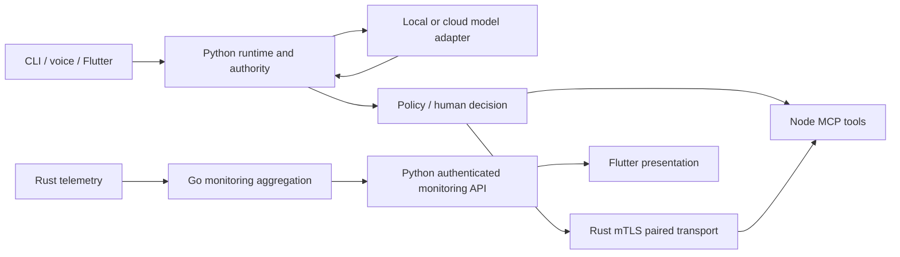

# Odessy architecture: a newcomer map

> DRAFT — proposed contributor routing, not a list of assigned owners.
> Status: unstable developer preview. The model proposes; Odessy decides.

New here? Read [the story](story.md) for the intended end-to-end experience and how it
differs from what is qualified today, then pick an unclaimed task from the
[starter-issue drafts](contributor-issues.md).

Go monitoring has partial local integration evidence and is **not shipped as a
supported preview feature**. Commands below are component entry points after
[development setup](../CONTRIBUTING.md#development-setup), not whole-product qualification.

| Component / directory | Language and responsibility | Build / check alone | Suggested contributors |
|---|---|---|---|
| [`src/odessy/runtime/`](../src/odessy/runtime/) and [`models/`](../src/odessy/models/) | Python loop, sessions, model adapters | Root: `python -m pip install -e ".[test,ui]"`; `python -m pytest -q` | Runtime/model contributors; dispatch security needs maintainer review |
| [`src/odessy/authority/`](../src/odessy/authority/), [`execution/`](../src/odessy/execution/) | Python policy, workspace authority, sandbox | Root: `python -m pytest -q tests/test_authority_boundary.py tests/test_permission_hardening.py` | **maintainer review required**; not starter work |
| [`src/odessy/voice/`](../src/odessy/voice/) | Python capture, STT/TTS adapters and voice sessions | Root: `python -m pytest -q tests/test_speech_providers.py` | Provider examples/tests; approval changes need maintainer review |
| [`tools/`](../tools/) | TypeScript/Node MCP tools and host checks | In directory: `npm ci --no-audit --no-fund`, `npm run typecheck`, `npm test` | Tool contributors; guards and sandbox: **maintainer review required** |
| [`native/odessy-link/`](../native/odessy-link/) | Rust identity, enrollment, mTLS relay, telemetry | In directory: `cargo build --locked`, `cargo test --locked` | Rust contributors; enrollment, grants and keys: **maintainer review required** |
| [`apps/desktop/`](../apps/desktop/) | Dart/Flutter conversation, settings, interactions | In directory: `flutter pub get`, `flutter analyze`, `flutter test`; Windows build: `flutter build windows` | UI/accessibility contributors; UI is not execution authority |
| [`packages/odessy_client/`](../packages/odessy_client/) | Dart backend client and models | In directory: `dart pub get`, `dart analyze`, `dart test` | Client/API contributors; authentication needs maintainer review |
| [`services/monitoring/`](../services/monitoring/) | Go aggregation/internal API; experimental | In directory: `go build ./cmd/odessy-monitor`, `go test ./...` | Go/observability contributors; no execution authorization here |
| [`benchmark/`](../benchmark/) and [`evals/`](../evals/) | Python component measurements and simulated execution evals | Root: `python -m benchmark --help`; `python -m pytest -q tests/test_benchmark_harness.py tests/test_evals.py` | Measurement/fixture contributors; evals are not hardware qualification |
| [`docs/`](./) | Markdown/MDX guidance and evidence | Resolve links; verify commands against workflows | Good starting point for newcomers |

Credential storage and OS keyring integration, including
[`src/odessy/credentials.py`](../src/odessy/credentials.py) and the
[credential setup boundary](setup/secure-model-credentials.md): **maintainer review required**.
Read component-local `AGENTS.md` instructions before editing desktop/client code.

**Evidence:** [runtime layout](../README.md#python-source-layout),
[approval](reference/permissions.mdx#approval),
[pairing qualification](qualification/2026-10-23-interactions-and-pairing.md),
[monitoring status](releases/v0.5.0.md), [release limits](releases/v0.5.0-unstable-notes.md).
No MCU execution capability, complete sandbox or reliable voice is implied.
