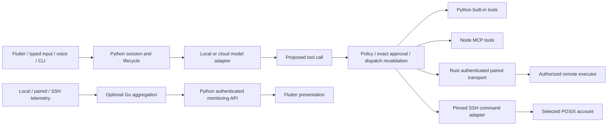

# Odessy architecture: a newcomer map

**English** | [简体中文](zh-CN/ARCHITECTURE.md) | [Español](es/ARCHITECTURE.md)

> Developer Preview · v0.5.0-alpha. Component responsibilities, not individual contributor assignments. The model proposes; Odessy decides.

The desktop starts the service. The model proposes an action, then the service checks policy and approval before dispatch. The execution target can be local or a separately authorized computer. This is the design behind Odessy’s voice-first goal.

For a first change, use the [file and test map](../CONTRIBUTING.md#choose-where-to-start).

## Architectural bets

## Where actions are gated

| Boundary | Actual source | What to preserve |
| --- | --- | --- |
| Proposal and dispatch | [`runtime/agent_loop.py`](../src/odessy/runtime/agent_loop.py) | Screen the proposal, snapshot its plan and revalidate immediately before dispatch. |
| Policy and exact approval | [`authority/policy.py`](../src/odessy/authority/policy.py), [`action_approval.py`](../src/odessy/authority/action_approval.py) | Hard denials, exact arguments/target/content and independent authorization scopes. |
| Interaction and mode | [`interaction/broker.py`](../src/odessy/interaction/broker.py), [`application/access_modes.py`](../src/odessy/application/access_modes.py) | A UI/voice answer resolves the bound request. Modes cannot create workspace or remote rights. |
| Execution adapters | [`tools/`](../src/odessy/tools), [`tools/src/`](../tools/src), [`execution/`](../src/odessy/execution) | Adapter-specific validation and available confinement. MCP protocol itself is not a permission grant. |
| SSH commands | [`tools/ssh_executor.py`](../src/odessy/tools/ssh_executor.py) | Exact approval, pinned host identity, bounded output and revocation; no remote sandbox or PTY. |

Not every tool runs through Node: Python built-ins and the SSH adapter also exist.
Go monitoring grants no command access, and Rust pairing identity is distinct from
execution grants. The experimental trusted-LAN executor has different boundaries;
do not treat it as equivalent to authenticated pairing. MCU automation is unimplemented.

## Desktop lifecycle and development entry points

The installed app uses `InstalledApplication` and `InstalledCoordinator` to select the
verified runtime, start one authenticated loopback service, pass session credentials
over private stdin and close the owned child. Source-managed desktop mode uses
`LocalDesktopApplication` with the same owner and a saved configured selection.
See [managed launch commands](getting-started.md).

`python -m odessy` is an implemented module entry point, also exposed as the `odessy`
console command. `doctor`, headless CLI and manually managed `serve` are developer or
operator interfaces. Their presence does not mean desktop users should exchange tokens
or start a second service. The engine identifier `legacy` currently names **Custom**;
it does not mark every Python module or CLI command as deprecated.

Go monitoring is an optional packaged component and remains opt-in. Use the
[SSH contributor path](../src/odessy/ssh/README.md) for the shared computer model,
capability boundaries and fixture checks. Packaging a helper or passing a local
fixture does not qualify every installed platform or remote direction.

- [`tool/`](../tool/) contains scripts to build and verify the project.
- [`tools/`](../tools/) is the Node MCP server.
- [`src/odessy/tools/`](../src/odessy/tools/) contains Python tool adapters, including the SSH executor.

| Component / directory | Language and responsibility | Contribution and review |
|---|---|---|
| [`src/odessy/runtime/`](../src/odessy/runtime) and [`models/`](../src/odessy/models) | Python loop, sessions, model adapters | Runtime/model contributors; dispatch security needs maintainer review |
| [`src/odessy/authority/`](../src/odessy/authority), [`execution/`](../src/odessy/execution) | Python policy, workspace authority, sandbox | **maintainer review required**; not starter work |
| [`src/odessy/voice/`](../src/odessy/voice) | Python capture, STT/TTS adapters and voice sessions | Provider examples/tests; approval changes need maintainer review |
| [`tools/`](../tools) | TypeScript/Node MCP tools and host checks | Tool contributors; guards and sandbox: **maintainer review required** |
| [`native/odessy-link/`](../native/odessy-link) | Rust identity, enrollment, mTLS relay, telemetry | Rust contributors; enrollment, grants and keys: **maintainer review required** |
| [`apps/desktop/`](../apps/desktop) | Dart/Flutter conversation, settings, interactions | UI/accessibility contributors; UI is not execution authority |
| [`packages/odessy_client/`](../packages/odessy_client) | Dart backend client and models | Client/API contributors; authentication needs maintainer review |
| [`services/monitoring/`](../services/monitoring) | Go aggregation/internal API; optional, opt-in | Go/observability contributors; no execution authorization here |
| [`docs/`](README.md) | Markdown/MDX guidance and evidence | Start with [open GitHub issues](https://github.com/Trisoma/odessy/issues) and the [ownership path](../CONTRIBUTING.md#path-to-area-ownership) |

Credential storage and OS keyring integration, including
[`src/odessy/credentials.py`](../src/odessy/credentials.py) and the
[credential setup boundary](setup/secure-model-credentials.md): **maintainer review required**.
Read component-local `AGENTS.md` instructions before editing desktop/client code.

**Evidence:** [runtime overview](../README.md),
[approval](reference/permissions.mdx#approval),
[current pairing scope](reference/host-pairing.mdx),
[monitoring status](monitoring/README.md), [release limits](current-status.md).
MCU support remains a future direction; confinement and physical voice reliability
require the platform-specific checks in the linked support matrix.

## Durable application services

Model adapters live in `src/odessy/models/`. Shared provider metadata in
`src/odessy/model_providers.py` also serves the minimal setup bootstrap. Local callers
use `models.build_local_model`, with shared presets in `models/__init__.py`. The Ollama
chat adapter accepts configured model names, including models outside the preset
families. Both local adapters share the bounded HTTP transport in `ollama_model.py`.
The canonical chat implementation is `models/ollama_chat.py`. Historical flat
imports such as `odessy.agent_loop` have been retired. Use domain imports such as
`odessy.runtime.agent_loop`.

The production application composition owns conversation SQLite lifecycle, Custom
continuation, access modes and trusted live workspace/session resolution. Context,
memory and retrieval extend that store without becoming authorization sources.
Terminal handles are ephemeral; checkpoints own Git refs and metadata, not user
branches or arbitrary files. Harness remains selectable without automatic fallback.
See [history](ui/conversation-history.md), [database ownership](database/README.md)
and [the current support matrix](current-status.md).

## Python source organization

`src/odessy` is the installable Python package. Keep code within its owning domain.

| Directory | Responsibility |
| --- | --- |
| `application/` | API routes, session lifecycle and durable application services |
| `runtime/` | Agent loop, scheduling, hooks and bounded conversation history |
| `runtime_backends/` | Runtime engine contracts and Custom/Harness adapters |
| `models/` | Model adapters, local construction, routing and usage |
| `authority/` | Policy, approvals, redaction and audit boundaries |
| `execution/` | Host isolation, resource limits and execution providers |
| `tools/` | MCP clients, servers and guarded tool transport |
| `voice/` | Audio capture, playback, speech providers and voice interaction |
| `collaboration/` | Participants, jobs and handoffs |
| `config/` | Configuration loading, validation and diagnostics |
| `setup/` | Installation, maintenance and component configuration |
| `monitoring/`, `ssh/`, `devices/` | Host monitoring, SSH identity and device declarations |

Routes compose existing service owners. Model adapters produce proposals through
shared runtime types. Authority and execution enforce grants at dispatch. Keep
channel-independent conversation logic in `runtime/` and audio logic in `voice/`.
