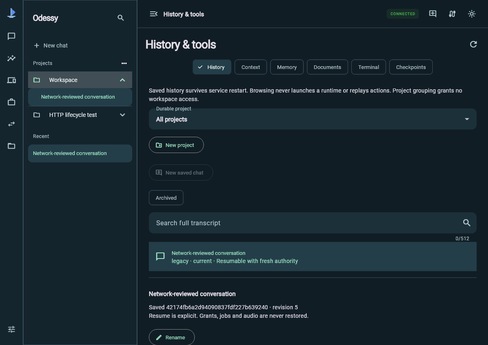
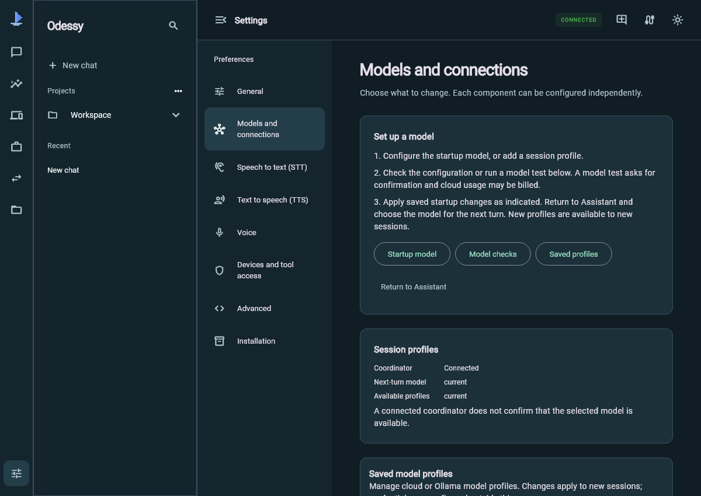
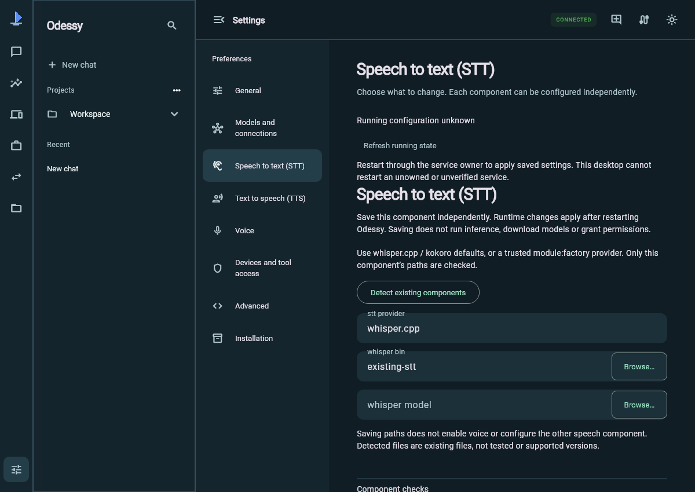
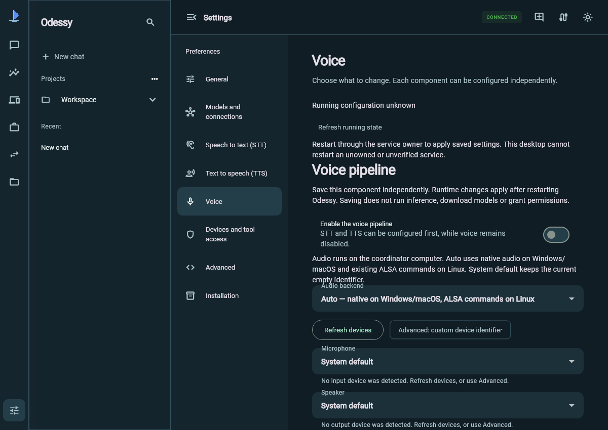
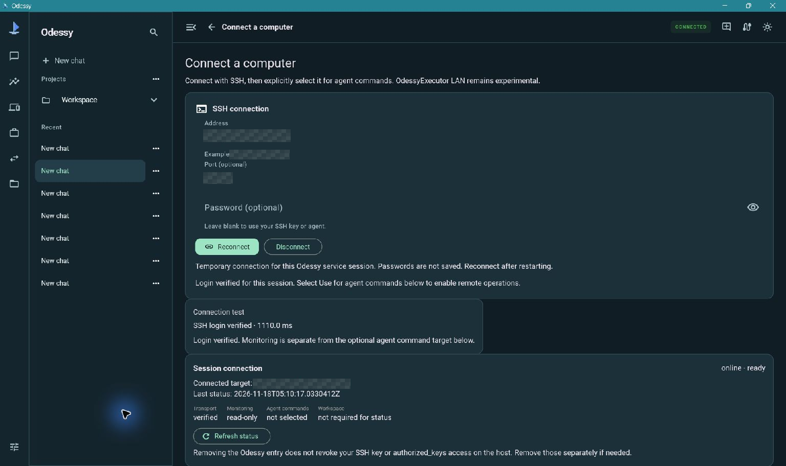

# Odessy desktop manual

**English** | [简体中文](zh-CN/GOLDEN_PATH.md) | [Español](es/GOLDEN_PATH.md)

**Developer Preview · v0.5.0-alpha · Windows 11**

Open Odessy on Windows 11 x64, connect a model and check the actual output of a local command. The first run needs one PC; voice and SSH can wait.

## 1. Install and open Odessy

### Prerequisites

You’ll need internet access, a disposable local folder and a DeepSeek key with model access for this example. No GPU, microphone or second computer is needed.

DeepSeek can charge for requests and receives request data and permitted tool observations. Windows confinement is partial.

### A. Install on Windows

[Download the Windows x64 installer](https://github.com/Trisoma/odessy/releases/download/v0.5.0-alpha/Odessy-v0.5.0-alpha-windows-x64-setup.exe). This EXE predates the security fixes in `08efca9`. If you need those fixes, [run from source](getting-started.md). To check the published EXE before opening it, run this in PowerShell from your download folder:

```powershell
Get-FileHash -Algorithm SHA256 -LiteralPath '.\Odessy-v0.5.0-alpha-windows-x64-setup.exe'
```

Expected SHA-256: `2d634100c87251f3f685fdf0a43b734b534b08b6d8643d7e1458c25992abf47a`.

1. Open the verified EXE, choose a folder and keep the default coordinator with local execution. The installer includes its runtime.
2. For typed chat, skip speech and wake. To add speech now, select **Install voice components**, choose **Piper** (recommended on CPU) or **Kokoro**, and review the downloads and licenses. The wake model is a separate opt-in. See [Voice components](setup/voice-components.md).
3. Review the plan, select **Install** and wait for completion. Choose **Open Odessy**.

For an existing versioned installation, use its recorded location and review **Manage installation**. Keep the profile and voice assets. See [maintenance](setup/wizard.md#management) and [speech-cache recovery](setup/voice-components.md#upgrading-after-removing-the-speech-cache).

### B. Build the production desktop from source

Follow [Getting started](getting-started.md), then return here to configure a model.



*Desktop gallery example. Existing gallery/SSH images retain their recorded source identity; they are not new captures of this installer.*

## 2. Configure DeepSeek

In **Settings → Models and connections**, choose **DeepSeek**, keep `https://api.deepseek.com/v1`, and select `deepseek-flash`, the model I tested. Enter the API key in the masked field. Choose **Save securely** or **Use for this session only** and save. Follow any apply/reconnect prompt or use **Connect saved configuration**. In a new Custom chat, send a short message and check the active model and reply. [Credentials](setup/secure-model-credentials.md)



*Desktop gallery example. Select the model and provider in Models and connections.*

## 3. Run a command on your Windows laptop

In **Workspaces**, select a disposable local folder and apply any restart prompt. Disconnect any active SSH or LAN execution target. Run `hostname` first. It prints the computer’s name without changing files.

1. Open a new **Custom** chat. In the composer’s shield menu (**Service permissions**), choose **Ask every time** and wait for the service to confirm the change.
2. Send this prompt:

   ```text
   Use terminal.run to run exactly hostname on this Windows laptop in the current workspace. Do not use SSH, substitute another command, or retry if I deny it. Show the tool's stdout and exit code.
   ```

3. Check the approval. It should show local `terminal.run`, the command `hostname`, and the workspace you selected. If the approval is missing or anything differs, stop and [check your settings](#if-the-approval-never-appears). When it matches, choose **Approve once**.
4. Open **Output** in the active chat. Look for exit code `0` and the same name you get by running `hostname` yourself in PowerShell.

**You can stop here.** Your model replied and Odessy showed the result of an approved command on your laptop.

[](view/main/basic-chat.png)

*Installed Windows preview showing actual command output from a file listing. Open **Output** in the same place to see your own result.*

### Optional: check that Deny stops a command

Send the same prompt as a new request. Check that it names the same local command and workspace, then choose **Deny**. Look for a denied result and no successful command output for that request. If the model proposes a replacement command, stop the turn.

## 4. Optional: configure voice and the wake word

Configure compatible speech components in the installed or managed source app before this exercise. Source build dependencies do not include the speech models or all audio dependencies; follow [Voice components](setup/voice-components.md). The managed source launch uses the configured voice lifecycle, while a separately launched manual API server may omit it.

1. In **Settings**, open **Speech to text**, **Text to speech**, and **Voice** to choose your supported speech components, microphone and output device. Save the changes. If prompted to supply or download assets, follow [Voice components](setup/voice-components.md). Wake models are a separate opt-in.
2. Open the composer's **Voice options → Test speech output**. Then choose **Test speech input · no model call** and say a short sentence. Check the playback and transcript separately.
3. Try push-to-talk. Then enable wake listening. With the bundled Jarvis model, say **“Hey Jarvis”**, wait for the listening cue, and ask a short question.
4. Stop wake listening from the voice controls before changing audio devices. If a settings change is deferred, finish the current audio operation and check that the change applies when audio is idle.





*Desktop gallery examples. Speech recognition configures transcription. Voice settings control the listening behavior.*

If there is no transcript, start with the microphone and input test. If text arrives slowly after a transcript appears, check the model response. If text appears before speech, check synthesis and the selected speaker. Voice can feel slow on the tested setup. Include the stage where you observed the delay when reporting it.

## 5. Optional: run a command on another computer over SSH

As in the local exercise, `hostname` prints the selected computer's name. Here the command runs on the SSH computer rather than your Windows laptop. The worked setup example is a **Jetson Orin Nano Super**. Use your own reachable SSH computer with a POSIX shell and an account you can already log into. Connection addresses are omitted from this guide and redacted in the screenshots.

1. In **Devices → Connect a computer**, enter an SSH alias or `user@hostname`. Fill in the port if required. Leave the password blank to use your configured SSH key or agent. Verify the host key independently and follow the [SSH trust instructions](setup/ssh-computers.md) if it is unknown or changed.

   

   *Real installed Odessy window after login to the maintainer's Debian computer. The address, port and address helper example are mosaicked for privacy. The password field is empty. Use your own connection details.*

2. Select **Connect**. Login starts read-only monitoring. Open **Devices → Overview** to find the connected computer and its discovered hostname. Check monitoring freshness separately from login status.

   

   *Real Devices overview. The connected Debian computer reports the hostname `localhost` and appears online with read-only SSH monitoring. The separate `jetson` card is a saved entry, not the computer connected in this capture. Connection identity is mosaicked.*

3. Return to **Connect a computer**. Login alone does not enable agent commands: the status below shows **Agent commands · not selected**. Scroll to **Use for agent commands** and select it separately. This opens a new Custom chat with the SSH tool available.

   

   *Real installed Odessy window, scrolled to show **Use for agent commands**. Login and transport are verified; the session is online and ready, while agent commands remain **not selected**. This capture precedes command access. Private connection details are mosaicked.*

4. In the new chat, type **“On the selected SSH computer, run `hostname` using `ssh.run`.”** Check the exact command and target in the approval and decline it once. Confirm there is no successful remote result for that request. Ask again, review the approval, and approve once. Check the returned tool output and exit code in the active chat's **Output** panel.
5. Compare the two exercises: local `hostname` should return your Windows laptop's name; remote `hostname` should return the selected SSH computer's name. Select **Disconnect agent commands** when finished.

The maintainer's saved SSH exchange came from a **separate Debian x86-64 computer**, not the Jetson setup example. Its recorded `ssh.run` result was:

```text
stdout: localhost
exit code: 0
```

This is a text excerpt of the confirmed tool result, not a command-result screenshot. `localhost` was that Debian computer's configured hostname; it does not mean the SSH command ran on the Windows coordinator. On your own host, compare with `hostname` in an independent SSH session.

When the saved SSH chat was reopened, the assistant reply was visible but the resumed session's **Output** panel was empty. No live SSH tool-output screenshot was saved. The real connection and Devices captures above establish login and connection state; they do not show command execution. For the exercises, inspect Output while the command's live session is active.

The full-window SSH captures were taken from the installed app on **18 November 2026**. Their installed executable identity, privacy edits and evidence limits are recorded in the [capture manifest](view/manual-ssh-live/manifest.json).

The current SSH flow has several manual steps. Monitoring and command selection have separate controls, enabling commands starts a new chat, and restarting the service requires reconnecting. Commands run with the SSH account's permissions and without a remote sandbox. Use the target shown in the approval to distinguish a remote command from a laptop command. The [SSH guide](setup/ssh-computers.md) covers connection loss and supported targets.

## 6. Optional: explore the desktop

| Where | What to try |
| --- | --- |
| **Projects and history** | Create or switch projects, open a saved chat, search history, or use the chat menu to rename, pin, archive or export. Custom supports bounded continuation after restart. Harness restart history is read-only. |
| **Composer** | Change the model for the next turn. Open service permissions and check the effective mode. SSH commands still require explicit approval. |
| **Inspector** | Browse workspace **Files**, recorded **Output**, and **Changes**. An available interactive **Terminal** uses a separate shell grant and runs under your OS account. [Terminal and checkpoints](ui/terminal-checkpoints.md) |
| **Context, memory and documents** | Inspect context used by a turn, review project memory, or opt in to document indexing and follow retrieval citations. Availability depends on runtime and configuration. |
| **Checkpoints** | Review or preview recorded workspace checkpoints. Windows supports checkpoint creation, listing, preview and restoration with handle-anchored protection. |
| **Activity & usage** | Check recorded activity and model usage for this installation. |
| **Devices, Jobs and Handoffs** | Check available hosts, then inspect recorded jobs or handoffs when the corresponding feature has activity. |
| **Settings** | Explore general appearance, models and connections, speech to text, text to speech, voice, devices and tool access, advanced settings and installation maintenance. |

[Browse the illustrated desktop gallery](view/README.md) · [Current limitations](../LIMITATION.md)

## Troubleshooting and reporting

These are known constraints and likely failure points on this walkthrough. The [full limitations](../LIMITATION.md) also cover capabilities outside the core path.

| Symptom or boundary | What to do |
| --- | --- |
| Python, npm or Flutter setup fails | Check the prerequisites, Python 3.13 launcher, Node 22 and `flutter doctor -v`. Windows C++ tools are required for native builds. Do not continue after a failed dependency/build command. |
| Startup fails, connection refused or HTTP 401 | In the managed app, inspect the startup error and saved configuration, then retry **Connect saved configuration**. It owns its port/token. Source builds need all managed-launch defines. Only a deliberately manual API connection uses operator-entered ports/tokens. |
| Model reports authentication, model-not-found, rate-limit or credit errors | Check provider endpoint, current model ID and account access/credit. Doctor finding a key does not validate it online. Report the provider error without the key. Do not assume a failed request was free. |
| Secure key save fails | Use **Use for this session only** deliberately or repair the supported OS credential backend. Both managed launch routes pass session credentials privately; saving a key in plaintext is not a workaround. |
| No approval, or a different command/target appears | Check Custom, effective **Ask every time**, local target, selected workspace and any saved command preapprovals/hooks. Deny mismatched requests; see [the policy check](#if-the-approval-never-appears). Neither a panel nor a mode selection grants new workspace rights. |
| Denied command is proposed again | Denial does not execute that proposal. Stop the turn and report the repeated proposal; do not approve it merely to make the UI progress. |
| Command fails or exit code is nonzero | Read the actual Output and approval arguments. Check workspace validity and shell/tool readiness. Do not disable confinement or use Full control as a setup workaround. Windows confinement remains partial even when the command succeeds. |
| Output is empty after reopening history | The maintainer observed an empty resumed SSH Output panel. Inspect and capture the live tool result before closing the chat; do not rerun an action just to recreate evidence. History and assistant prose are not proof of new execution. |
| Saved chat cannot continue | Use the matching profile/workspace. Custom continuation is bounded; Harness restart history is read-only. Do not delete the history database to repair selection. |
| Optional voice or Devices is unavailable | Typed local chat does not require either feature. Check the selected audio device and individual STT/TTS tests; SSH login, monitoring readiness and command authorization are separate. Reconnect temporary SSH sessions after service restart. |
| A cloud or shell action exposes data | Cloud requests and allowed tool observations are sent to the configured provider. Shell actions have the documented host permissions; approvals are not a complete OS sandbox. Use disposable, non-sensitive data. Checkpoint restoration only restores captured text files and is not a rollback for executed commands. |

### If the approval never appears

With the default policy, the non-executing check below reports `decision: confirm` and `asks: true`. Run it from your disposable workspace using the source environment's Python if the UI unexpectedly skips the approval:

```powershell
$previewPython = 'C:\path\to\odessy-preview\.venv\Scripts\python.exe'
& $previewPython -m odessy permissions check 'hostname' --json
```

Replace `C:\path\to\odessy-preview` with your actual source checkout. This optional diagnostic requires that checkout's Python environment; installed-only users can report the visible approval and Output instead.

This check never runs `hostname` and does not override live mode, custom rules, hooks or saved preapprovals. **Ask every time** does not mean every harmless read prompts. If your configuration differs, report it; do not weaken policy to force this exercise to pass.

### Collect diagnostics

**Installer:** open **Settings → Manage installation → Check installed files** and record the build. **Source:** use [Diagnose a failed start](getting-started.md#diagnose-a-failed-start) for the command and its limits.

[Open an issue](https://github.com/Trisoma/odessy/issues/new/choose) with the version, Windows version, the step that failed, and what you saw. For a command, include the target, output and exit code you saw. If you tried **Deny**, say what happened. Remove keys, tokens, private addresses and sensitive paths before sharing logs or screenshots.

## Help improve the part you just tried

Pick an issue in the [roadmap](ROADMAP.md) and check the [contribution guide](../CONTRIBUTING.md) for its first test.
