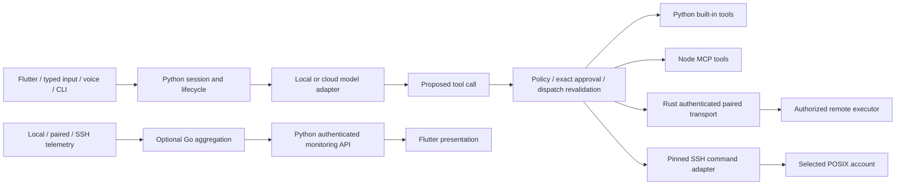

# Arquitectura de Odessy: un mapa para recién llegados

[English](../ARCHITECTURE.md) | [简体中文](../zh-CN/ARCHITECTURE.md) | **Español**

**Vista previa para desarrolladores · v0.5.0-alpha**

> Nota: la versión en inglés es la versión canónica; esta traducción es solo de referencia. Las capturas muestran la interfaz en inglés; la aplicación aún no está localizada.

El escritorio inicia el servicio. El modelo propone una acción y el servicio verifica la política y la aprobación antes de ejecutarla. El destino puede ser local u otro equipo con autorización propia. Este diseño sostiene la idea de usar la voz como interfaz principal.

Para un primer cambio, consulta el [mapa de archivos y pruebas](CONTRIBUTING.md#elegir-por-dónde-empezar).

## Apuestas arquitectónicas

## Dónde se controlan las acciones

| Límite | Fuente real | Qué preservar |
| --- | --- | --- |
| Propuesta y despacho | [`runtime/agent_loop.py`](../../src/odessy/runtime/agent_loop.py) | Filtrar la propuesta, tomar una instantánea de su plan y revalidar justo antes del despacho. |
| Política y aprobación exacta | [`authority/policy.py`](../../src/odessy/authority/policy.py), [`action_approval.py`](../../src/odessy/authority/action_approval.py) | Denegaciones duras, argumentos/destino/contenido exactos y ámbitos de autorización independientes. |
| Interacción y modo | [`interaction/broker.py`](../../src/odessy/interaction/broker.py), [`application/access_modes.py`](../../src/odessy/application/access_modes.py) | Una respuesta de la UI/voz resuelve la solicitud vinculada. Los modos no pueden crear derechos de espacio de trabajo ni remotos. |
| Adaptadores de ejecución | [`tools/`](../../src/odessy/tools), [`tools/src/`](../../tools/src), [`execution/`](../../src/odessy/execution) | Validación específica de cada adaptador y confinamiento disponible. El protocolo MCP en sí no es una concesión de permisos. |
| Comandos SSH | [`tools/ssh_executor.py`](../../src/odessy/tools/ssh_executor.py) | Aprobación exacta, identidad de host fijada, salida acotada y revocación; sin sandbox remoto ni PTY. |

No todas las herramientas se ejecutan a través de Node: también existen las integradas de Python y el adaptador SSH.
La monitorización en Go no concede acceso a comandos, y la identidad de emparejamiento en Rust es distinta de las concesiones de ejecución. El ejecutor experimental de LAN de confianza tiene límites diferentes; no lo trates como equivalente al emparejamiento autenticado. La automatización de MCU no está implementada.

## Ciclo de vida de la aplicación de escritorio y puntos de entrada para desarrollo

La aplicación instalada usa `InstalledApplication` y `InstalledCoordinator` para seleccionar el runtime verificado, iniciar un único servicio de loopback autenticado, pasar las credenciales de sesión por stdin privado y cerrar el proceso hijo propio. El modo de escritorio gestionado desde el código fuente usa `LocalDesktopApplication` con el mismo propietario y una selección configurada guardada.
Consulta los [comandos de lanzamiento gestionado](./getting-started.md).

`python -m odessy` es un punto de entrada de módulo implementado, también expuesto como el comando de consola `odessy`. `doctor`, la CLI sin interfaz y el `serve` gestionado manualmente son interfaces para desarrolladores u operadores. Su presencia no significa que los usuarios de escritorio deban intercambiar tokens ni iniciar un segundo servicio. El identificador de motor `legacy` actualmente nombra a **Custom**; no marca todos los módulos de Python ni todos los comandos de CLI como obsoletos.

La monitorización en Go es un componente empaquetado opcional y sigue siendo opt-in. Usa la [vía de colaboración de SSH](../../src/odessy/ssh/README.md) (solo en inglés) para el modelo de computadora compartida, los límites de capacidad y las comprobaciones con fixtures. Empaquetar un helper o pasar un fixture local no califica todas las plataformas instaladas ni todas las direcciones remotas.

- [`tool/`](../../tool/) reúne los scripts de compilación y verificación.
- [`tools/`](../../tools/) es el servidor MCP en Node.
- [`src/odessy/tools/`](../../src/odessy/tools/) contiene los adaptadores de herramientas de Python, incluido el ejecutor SSH.

| Componente / directorio | Lenguaje y responsabilidad | Contribución y revisión |
|---|---|---|
| [`src/odessy/runtime/`](../../src/odessy/runtime) y [`models/`](../../src/odessy/models) | Bucle de Python, sesiones, adaptadores de modelo | Colaboradores de runtime/modelos; la seguridad del despacho requiere revisión de mantenedores |
| [`src/odessy/authority/`](../../src/odessy/authority), [`execution/`](../../src/odessy/execution) | Política de Python, autoridad de espacio de trabajo, sandbox | **se requiere revisión de mantenedores**; no es trabajo para principiantes |
| [`src/odessy/voice/`](../../src/odessy/voice) | Captura en Python, adaptadores STT/TTS y sesiones de voz | Ejemplos/pruebas de proveedores; los cambios de aprobación requieren revisión de mantenedores |
| [`tools/`](../../tools) | Herramientas MCP en TypeScript/Node y comprobaciones de host | Colaboradores de herramientas; guardas y sandbox: **se requiere revisión de mantenedores** |
| [`native/odessy-link/`](../../native/odessy-link) | Identidad Rust, enrolamiento, relay mTLS, telemetría | Colaboradores de Rust; enrolamiento, concesiones y claves: **se requiere revisión de mantenedores** |
| [`apps/desktop/`](../../apps/desktop) | Conversación, ajustes e interacciones en Dart/Flutter | Colaboradores de UI/accesibilidad; la UI no es autoridad de ejecución |
| [`packages/odessy_client/`](../../packages/odessy_client) | Cliente backend y modelos en Dart | Colaboradores de cliente/API; la autenticación requiere revisión de mantenedores |
| [`services/monitoring/`](../../services/monitoring) | Agregación/API interna en Go; opcional, opt-in | Colaboradores de Go/observabilidad; aquí no hay autorización de ejecución |
| [`docs/`](README.md) | Guías y evidencia en Markdown/MDX | Empieza con los [issues abiertos en GitHub](https://github.com/Trisoma/odessy/issues) y la [ruta hacia la responsabilidad de un área](./CONTRIBUTING.md#ruta-hacia-la-responsabilidad-de-un-área) |

El almacenamiento de credenciales y la integración con el llavero del sistema operativo, incluidos
[`src/odessy/credentials.py`](../../src/odessy/credentials.py) y el
[límite de configuración de credenciales](../setup/secure-model-credentials.md) (solo en inglés): **se requiere revisión de mantenedores**.
Lee las instrucciones de los `AGENTS.md` locales de cada componente antes de editar el código de escritorio/cliente.

**Evidencia:** [resumen del runtime](../../README.es.md),
[aprobación](../reference/permissions.mdx#approval) (solo en inglés),
[alcance actual del emparejamiento](../reference/host-pairing.mdx) (solo en inglés),
[estado de la monitorización](../monitoring/README.md) (solo en inglés), [límites de la versión](./current-status.md).
El soporte de MCU sigue siendo una dirección futura; el confinamiento y la fiabilidad de la voz física
requieren las comprobaciones específicas de plataforma de la matriz de soporte enlazada.

## Servicios de aplicación duraderos

Los adaptadores de modelo viven en `src/odessy/models/`. Los metadatos compartidos de proveedores en
`src/odessy/model_providers.py` también sirven al arranque mínimo de configuración. Los llamadores locales
usan `models.build_local_model`, con presets compartidos en `models/__init__.py`. El adaptador de chat de Ollama
acepta nombres de modelo configurados, incluidos modelos fuera de las familias predefinidas. Ambos adaptadores
locales comparten el transporte HTTP acotado de `ollama_model.py`.
La implementación canónica del chat es `models/ollama_chat.py`. Las importaciones planas históricas
como `odessy.agent_loop` se han retirado. Usa importaciones de dominio como
`odessy.runtime.agent_loop`.

La composición de la aplicación de producción posee el ciclo de vida de SQLite de conversación, la continuación de
Custom, los modos de acceso y la resolución confiable del espacio de trabajo/sesión en vivo. El contexto,
la memoria y la recuperación extienden ese almacén sin convertirse en fuentes de autorización.
Los handles de terminal son efímeros; los checkpoints poseen referencias Git y metadatos, no ramas de usuario
ni archivos arbitrarios. Harness sigue siendo seleccionable sin cambiar automáticamente de motor.
Consulta [historial](../ui/conversation-history.md) (solo en inglés), [propiedad de la base de datos](../database/README.md) (solo en inglés)
y [la matriz de soporte actual](./current-status.md).

## Organización del código fuente en Python

`src/odessy` es el paquete de Python instalable. Mantén el código dentro del dominio al que pertenece.

| Directorio | Responsabilidad |
| --- | --- |
| `application/` | Rutas de API, ciclo de vida de sesiones y servicios de aplicación duraderos |
| `runtime/` | Bucle del agente, planificación, hooks e historial de conversación acotado |
| `runtime_backends/` | Contratos de motor de runtime y adaptadores Custom/Harness |
| `models/` | Adaptadores de modelo, construcción local, enrutamiento y uso |
| `authority/` | Política, aprobaciones, ocultación de datos sensibles y límites de auditoría |
| `execution/` | Aislamiento del host, límites de recursos y proveedores de ejecución |
| `tools/` | Clientes y servidores MCP, y transporte de herramientas con guardas |
| `voice/` | Captura y reproducción de audio, proveedores de voz e interacción por voz |
| `collaboration/` | Participantes, trabajos y traspasos |
| `config/` | Carga de configuración, validación y diagnósticos |
| `setup/` | Instalación, mantenimiento y configuración de componentes |
| `monitoring/`, `ssh/`, `devices/` | Monitorización del host, identidad SSH y declaraciones de dispositivos |

Las rutas componen los propietarios de servicio existentes. Los adaptadores de modelo producen propuestas mediante
tipos de runtime compartidos. La autoridad y la ejecución aplican las concesiones en el despacho. Mantén
la lógica de conversación independiente del canal en `runtime/` y la lógica de audio en `voice/`.
