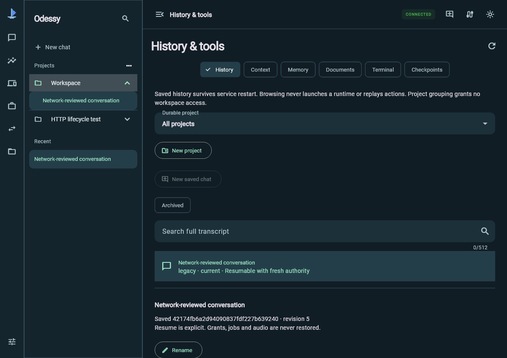
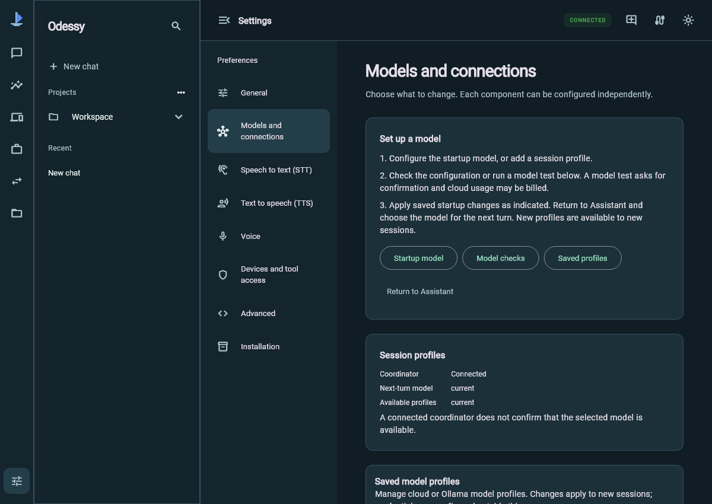
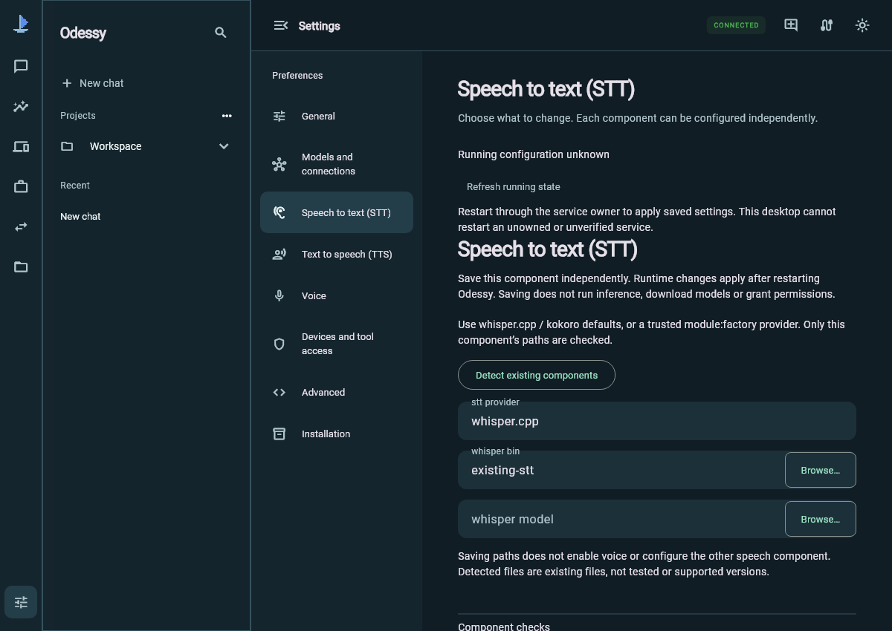
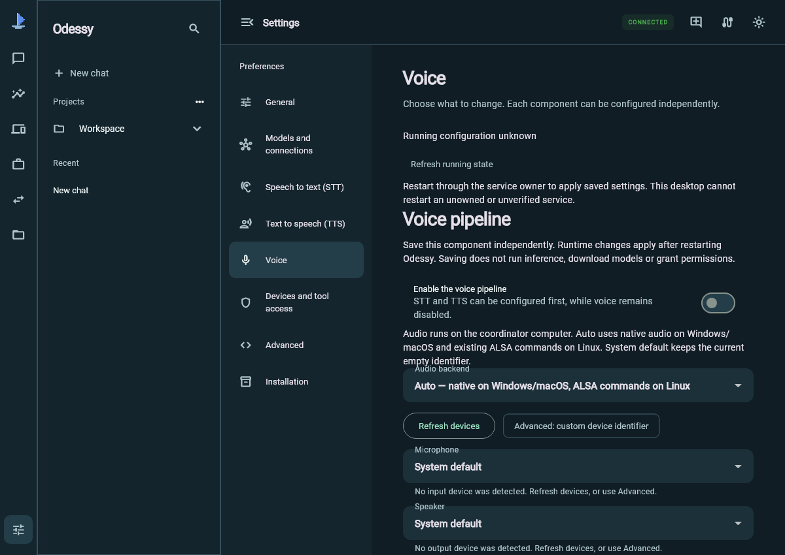
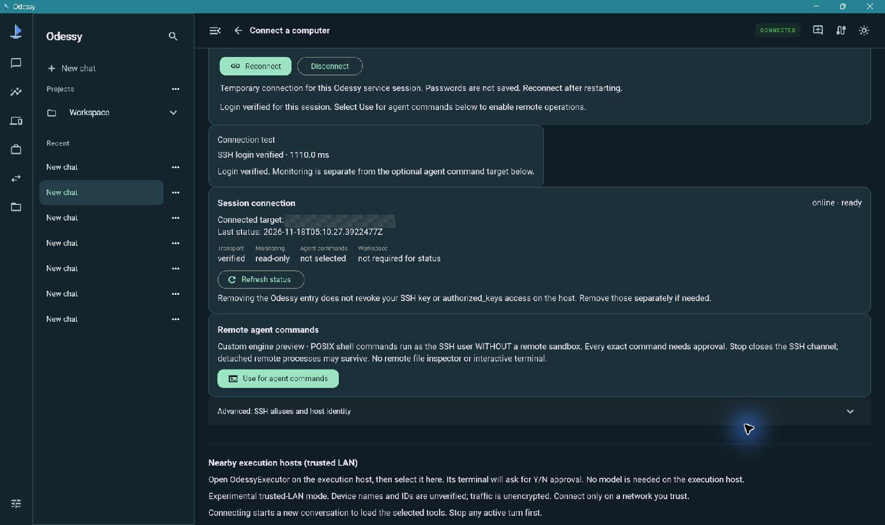

# Manual de escritorio de Odessy

[English](../GOLDEN_PATH.md) | [简体中文](../zh-CN/GOLDEN_PATH.md) | **Español**

**Vista previa para desarrolladores · v0.5.0-alpha**

> Nota: la versión en inglés es la versión canónica; esta traducción es solo de referencia. Las capturas muestran la interfaz en inglés; la aplicación aún no está localizada.

Abre Odessy en Windows 11 x64, conecta un modelo y comprueba la salida real de un comando local. Para empezar basta con un equipo; puedes dejar la voz y SSH para después.

## 1. Instalar y abrir Odessy

### Requisitos previos

Para este ejemplo necesitas internet, una carpeta local desechable y una clave de DeepSeek con acceso al modelo. No hace falta GPU, micrófono ni otro equipo.

DeepSeek puede cobrar por las solicitudes y recibe sus datos y las observaciones permitidas de las herramientas. El confinamiento en Windows es parcial.

### A. Instalar en Windows

[Descarga el instalador de Windows x64](https://github.com/Trisoma/odessy/releases/download/v0.5.0-alpha/Odessy-v0.5.0-alpha-windows-x64-setup.exe). Este EXE es anterior a las correcciones de seguridad de `08efca9`. Si necesitas esas correcciones, [arranca desde el código](getting-started.md). Antes de abrir el EXE, ejecuta esto en PowerShell desde la carpeta de descargas:

```powershell
Get-FileHash -Algorithm SHA256 -LiteralPath '.\Odessy-v0.5.0-alpha-windows-x64-setup.exe'
```

SHA-256 esperado: `2d634100c87251f3f685fdf0a43b734b534b08b6d8643d7e1458c25992abf47a`.

1. Abre el EXE verificado, elige una carpeta y conserva el coordinador predeterminado con ejecución local. El instalador incluye su entorno de ejecución.
2. Para chatear por texto, omite la voz y la activación. Si quieres añadir voz ahora, activa **Install voice components**, elige **Piper** (recomendado para CPU) o **Kokoro** y revisa las descargas y licencias. El modelo de activación se elige aparte. Consulta los [componentes de voz](../setup/voice-components.md).
3. Revisa el plan, pulsa **Install** y espera a que termine. Selecciona **Open Odessy**.

Para actualizar una instalación versionada, usa su ubicación registrada y revisa **Manage installation**. Conserva el perfil y los recursos de voz. Consulta el [mantenimiento](../setup/wizard.md#management) y la [recuperación de la caché de voz](../setup/voice-components.md#upgrading-after-removing-the-speech-cache).

### B. Compilar el escritorio de producción desde el código fuente

Sigue [Primeros pasos](getting-started.md) y vuelve aquí para configurar un modelo.



*Ejemplo de la galería. Las imágenes existentes de la galería y de SSH conservan su identidad de código original; no son capturas nuevas de este instalador.*

## 2. Configurar DeepSeek

En **Settings → Models and connections**, elige **DeepSeek**, conserva `https://api.deepseek.com/v1` y selecciona `deepseek-flash`, el modelo que probé. Introduce la clave en el campo oculto. Elige **Save securely** o **Use for this session only** y guarda. Sigue la indicación para aplicar o reconectar, o usa **Connect saved configuration**. Envía un mensaje breve en un chat Custom nuevo y comprueba el modelo activo y la respuesta. [Credenciales](../setup/secure-model-credentials.md)



*Ejemplo de la galería de escritorio. Seleccionar el modelo y el proveedor en Models and connections (Modelos y conexiones).*

## 3. Ejecutar un comando en tu portátil Windows

En **Workspaces**, elige una carpeta local desechable y reinicia si la aplicación te lo pide. Desconecta cualquier destino de ejecución SSH o LAN activo. Empieza con `hostname`. Muestra el nombre del equipo sin cambiar archivos.

1. Abre un chat **Custom** nuevo. En el menú del escudo del cuadro de texto (**Service permissions**), elige **Ask every time** y espera a que el servicio confirme el cambio.
2. Envía este mensaje:

   ```text
   Use terminal.run to run exactly hostname on this Windows laptop in the current workspace. Do not use SSH, substitute another command, or retry if I deny it. Show the tool's stdout and exit code.
   ```

3. Revisa la solicitud de aprobación. Debe indicar `terminal.run` en local, el comando `hostname` y el espacio de trabajo que elegiste. Si no aparece o algún dato es distinto, detente y [revisa la configuración](#si-no-aparece-la-solicitud-de-aprobación). Si todo coincide, elige **Approve once**.
4. Abre **Output** en el chat activo. Comprueba que el código de salida sea `0` y que el nombre coincida con el que obtienes al ejecutar `hostname` en PowerShell.

**Ya puedes parar.** Tu modelo respondió y Odessy mostró el resultado de un comando que aprobaste en tu equipo.

[](../view/main/basic-chat.png)

*Vista de la versión instalada en Windows. El panel **Output** muestra el resultado de listar archivos. Abre ese mismo panel para ver tu resultado.*

### Opcional: comprueba que Deny detiene el comando

Envía el mismo mensaje como una solicitud nueva. Comprueba que indique el mismo comando local y espacio de trabajo, y elige **Deny**. Busca una denegación y comprueba que esa solicitud no tenga una ejecución exitosa. Si el modelo propone otro comando, detén el turno.

## 4. Opcional: configurar la voz y la palabra de activación

Configurar componentes de voz compatibles en la aplicación instalada o en la aplicación gestionada desde el código fuente antes de este ejercicio. Las dependencias de compilación del código fuente no incluyen los modelos de voz ni todas las dependencias de audio; seguir [Componentes de voz](../setup/voice-components.md) (solo en inglés). El arranque gestionado desde el código fuente usa el ciclo de vida de voz configurado, mientras que un servidor de API manual iniciado por separado puede omitirlo.

1. En **Settings** (Configuración), abrir **Speech to text** (Voz a texto), **Text to speech** (Texto a voz) y **Voice** (Voz) para elegir tus componentes de voz compatibles, el micrófono y el dispositivo de salida. Guardar los cambios. Si se pide proporcionar o descargar recursos, seguir [Componentes de voz](../setup/voice-components.md) (solo en inglés). Los modelos de activación son una opción separada (opt-in).
2. Abrir **Voice options → Test speech output** (Opciones de voz → Probar la salida de voz) en el compositor. Después elegir **Test speech input · no model call** (Probar la entrada de voz · sin llamada al modelo) y decir una frase corta. Comprobar la reproducción y la transcripción por separado.
3. Probar push-to-talk (pulsar para hablar). Después habilitar la escucha de activación. Con el modelo Jarvis incluido, decir **“Hey Jarvis”**, esperar la señal de escucha y hacer una pregunta corta.
4. Detener la escucha de activación desde los controles de voz antes de cambiar de dispositivo de audio. Si un cambio de configuración se aplaza, terminar la operación de audio en curso y comprobar que el cambio se aplica cuando el audio está inactivo.





*Ejemplos de la galería de escritorio. El reconocimiento de voz configura la transcripción. La configuración de Voice (Voz) controla el comportamiento de escucha.*

Si no hay transcripción, empezar por el micrófono y la prueba de entrada. Si el texto llega despacio después de que aparezca una transcripción, comprobar la respuesta del modelo. Si el texto aparece antes que el habla, comprobar la síntesis y el altavoz seleccionado. La voz puede resultar lenta en la configuración probada. Incluir la etapa en la que observaste el retraso al informar de ello.

## 5. Opcional: ejecutar un comando en otro equipo mediante SSH

Como en el ejercicio local, `hostname` imprime el nombre del equipo seleccionado. Aquí el comando se ejecuta en el equipo SSH en lugar de tu portátil Windows. El ejemplo de configuración desarrollado es un **Jetson Orin Nano Super**. Usar tu propio equipo SSH accesible con un shell POSIX y una cuenta en la que ya puedas iniciar sesión. Las direcciones de conexión se omiten en esta guía y se ocultan en las capturas.

1. En **Devices → Connect a computer** (Dispositivos → Conectar un equipo), introducir un alias SSH o `user@hostname`. Rellenar el puerto si es necesario. Dejar la contraseña en blanco para usar tu clave o agente SSH configurados. Verificar la clave del host de forma independiente y seguir las [instrucciones de confianza de SSH](../setup/ssh-computers.md) (solo en inglés) si es desconocida o ha cambiado.

   

   *Ventana real de Odessy instalada tras iniciar sesión en el equipo Debian del mantenedor. La dirección, el puerto y el ejemplo de ayuda de dirección están pixelados por privacidad. El campo de contraseña está vacío. Usar tus propios detalles de conexión.*

2. Seleccionar **Connect** (Conectar). El inicio de sesión comienza con un monitoreo de solo lectura. Abrir **Devices → Overview** (Dispositivos → Resumen) para encontrar el equipo conectado y su nombre de host detectado. Comprobar la frescura del monitoreo por separado del estado de inicio de sesión.

   

   *Resumen real de Devices (Dispositivos). El equipo Debian conectado informa el nombre de host `localhost` y aparece en línea con monitoreo SSH de solo lectura. La tarjeta `jetson` separada es una entrada guardada, no el equipo conectado en esta captura. La identidad de la conexión está pixelada.*

3. Volver a **Connect a computer** (Conectar un equipo). Solo con iniciar sesión no se habilitan los comandos del agente: el estado siguiente muestra **Agent commands · not selected** (Comandos del agente · no seleccionado). Desplazarse hasta **Use for agent commands** (Usar para comandos del agente) y seleccionarlo por separado. Esto abre un chat Custom nuevo con la herramienta SSH disponible.

   

   *Ventana real de Odessy instalada, desplazada para mostrar **Use for agent commands**. El inicio de sesión y el transporte están verificados; la sesión está en línea y lista, mientras que los comandos del agente siguen **not selected** (no seleccionados). Esta captura es anterior al acceso a comandos. Los detalles privados de la conexión están pixelados.*

4. En el chat nuevo, escribir **“On the selected SSH computer, run `hostname` using `ssh.run`.”** Comprobar el comando y el destino exactos en la aprobación y rechazarla una vez. Confirmar que no hay un resultado remoto correcto para esa solicitud. Volver a preguntar, revisar la aprobación y aprobar una vez. Comprobar la salida de herramienta devuelta y el código de salida en el panel **Output** (Salida) del chat activo.
5. Comparar los dos ejercicios: `hostname` en local debería devolver el nombre de tu portátil Windows; `hostname` en remoto debería devolver el nombre del equipo SSH seleccionado. Seleccionar **Disconnect agent commands** (Desconectar los comandos del agente) al terminar.

El intercambio SSH guardado del mantenedor provino de un **equipo Debian x86-64 separado**, no del ejemplo de configuración de Jetson. Su resultado `ssh.run` registrado fue:

```text
stdout: localhost
exit code: 0
```

Este es un extracto de texto del resultado de herramienta confirmado, no una captura del resultado del comando. `localhost` era el nombre de host configurado de ese equipo Debian; no significa que el comando SSH se ejecutara en el coordinador de Windows. En tu propio host, comparar con `hostname` en una sesión SSH independiente.

Al reabrir el chat SSH guardado, la respuesta del asistente era visible, pero el panel **Output** (Salida) de la sesión reanudada estaba vacío. No se guardó ninguna captura en vivo de la salida de herramienta SSH. Las capturas reales de conexión y de Devices (Dispositivos) anteriores establecen el inicio de sesión y el estado de conexión; no muestran la ejecución de comandos. Para los ejercicios, inspeccionar Output mientras la sesión en vivo del comando está activa.

Las capturas SSH de ventana completa se tomaron de la aplicación instalada el **18 de noviembre de 2026**. La identidad del ejecutable instalado, las ediciones de privacidad y los límites de la evidencia están registrados en el [manifiesto de capturas](../view/manual-ssh-live/manifest.json) (solo en inglés).

El flujo SSH actual tiene varios pasos manuales. El monitoreo y la selección de comandos tienen controles separados, habilitar los comandos inicia un chat nuevo y reiniciar el servicio exige volver a conectar. Los comandos se ejecutan con los permisos de la cuenta SSH y sin sandbox remoto. Usar el destino que se muestra en la aprobación para distinguir un comando remoto de un comando del portátil. La [guía de SSH](../setup/ssh-computers.md) (solo en inglés) cubre la pérdida de conexión y los destinos compatibles.

## 6. Opcional: explorar el escritorio

| Dónde | Qué probar |
| --- | --- |
| **Projects and history** (Proyectos e historial) | Crear o cambiar de proyecto, abrir un chat guardado, buscar en el historial o usar el menú del chat para renombrar, fijar, archivar o exportar. Custom admite una continuación acotada tras un reinicio. El historial de reinicio de Harness es de solo lectura. |
| **Composer** (Compositor) | Cambiar el modelo para el siguiente turno. Abrir los permisos del servicio y comprobar el modo efectivo. Los comandos SSH siguen requiriendo aprobación explícita. |
| **Inspector** | Explorar **Files** (Archivos) del espacio de trabajo, **Output** (Salida) registrado y **Changes** (Cambios). Un **Terminal** interactivo disponible usa una concesión de shell separada y se ejecuta bajo tu cuenta del sistema operativo. [Terminal y puntos de control](../ui/terminal-checkpoints.md) (solo en inglés) |
| **Context, memory and documents** (Contexto, memoria y documentos) | Inspeccionar el contexto usado por un turno, revisar la memoria del proyecto o habilitar la indexación de documentos y seguir las citas de recuperación. La disponibilidad depende del motor y de la configuración. |
| **Checkpoints** (Puntos de control) | Revisar o previsualizar los puntos de control registrados del espacio de trabajo. Windows admite la creación, el listado, la vista previa y la restauración de puntos de control con protección anclada a identificadores. |
| **Activity & usage** (Actividad y uso) | Comprobar la actividad registrada y el uso de modelos de esta instalación. |
| **Devices, Jobs and Handoffs** (Dispositivos, trabajos y traspasos) | Comprobar los hosts disponibles y después inspeccionar los trabajos o traspasos registrados cuando la funcionalidad correspondiente tenga actividad. |
| **Settings** (Configuración) | Explorar la apariencia general, los modelos y las conexiones, la voz a texto, el texto a voz, la voz, los dispositivos y el acceso a herramientas, la configuración avanzada y el mantenimiento de la instalación. |

[Explorar la galería ilustrada del escritorio](../view/README.md) (solo en inglés) · [Limitaciones actuales](./LIMITATION.md)

## Solución de problemas y reporte

Estas son limitaciones conocidas y puntos de fallo probables en este recorrido. Las [limitaciones completas](./LIMITATION.md) también cubren capacidades fuera de la ruta principal.

| Síntoma o límite | Qué hacer |
| --- | --- |
| Falla la preparación de Python, npm o Flutter | Comprobar los requisitos previos, el iniciador de Python 3.13, Node 22 y `flutter doctor -v`. Las herramientas de C++ de Windows son necesarias para las compilaciones nativas. No continuar después de que falle un comando de dependencia o de compilación. |
| Falla el arranque, se rechaza la conexión o aparece HTTP 401 | En la aplicación gestionada, inspeccionar el error de arranque y la configuración guardada y después reintentar **Connect saved configuration** (Conectar la configuración guardada). Es la dueña de su propio puerto y de su token. Las compilaciones desde el código fuente necesitan todas las definiciones del arranque gestionado. Solo una conexión de API deliberadamente manual usa puertos y tokens introducidos por el operador. |
| El modelo informa errores de autenticación, de modelo no encontrado, de límite de velocidad o de crédito | Comprobar el endpoint del proveedor, el ID de modelo actual y el acceso o crédito de la cuenta. Que doctor encuentre una clave no la valida en línea. Informar del error del proveedor sin la clave. No suponer que una solicitud fallida fue gratuita. |
| Falla el guardado seguro de la clave | Usar deliberadamente **Use for this session only** (Usar solo en esta sesión) o reparar el backend de credenciales del sistema operativo compatible. Ambas rutas de arranque gestionado pasan las credenciales de sesión de forma privada; guardar una clave en texto plano no es una solución alternativa. |
| No aparece ninguna aprobación, o aparece un comando o destino diferente | Comprobar Custom, el **Ask every time** (Preguntar cada vez) efectivo, el destino local, el espacio de trabajo seleccionado y cualquier preaprobación o hook de comandos guardados. Denegar las solicitudes que no coincidan; consultar [la comprobación de política](#si-no-aparece-la-solicitud-de-aprobación). Ni un panel ni una selección de modo conceden nuevos derechos sobre el espacio de trabajo. |
| Se vuelve a proponer un comando denegado | La denegación no ejecuta esa propuesta. Detener el turno e informar de la propuesta repetida; no aprobarla solo para que la interfaz avance. |
| El comando falla o el código de salida no es cero | Leer el Output real y los argumentos de la aprobación. Comprobar la validez del espacio de trabajo y la preparación del shell o la herramienta. No deshabilitar el confinamiento ni usar el control total como solución alternativa de configuración. El confinamiento en Windows sigue siendo parcial incluso cuando el comando se ejecuta correctamente. |
| La salida está vacía tras reabrir el historial | El mantenedor observó un panel Output vacío en la sesión SSH reanudada. Inspeccionar y capturar el resultado de herramienta en vivo antes de cerrar el chat; no volver a ejecutar una acción solo para recrear la evidencia. El historial y la prosa del asistente no son prueba de una nueva ejecución. |
| Un chat guardado no puede continuar | Usar el perfil y el espacio de trabajo correspondientes. La continuación de Custom es acotada; el historial de reinicio de Harness es de solo lectura. No eliminar la base de datos del historial para reparar la selección. |
| La voz opcional o Devices (Dispositivos) no está disponible | El chat local escrito no necesita ninguna de las dos funcionalidades. Comprobar el dispositivo de audio seleccionado y las pruebas individuales de STT/TTS; el inicio de sesión SSH, la preparación del monitoreo y la autorización de comandos son independientes. Volver a conectar las sesiones SSH temporales después de reiniciar el servicio. |
| Una acción en la nube o de shell expone datos | Las solicitudes en la nube y las observaciones de herramientas permitidas se envían al proveedor configurado. Las acciones de shell tienen los permisos documentados del host; las aprobaciones no son un sandbox completo del sistema operativo. Usar datos desechables y no sensibles. La restauración de puntos de control solo recupera archivos de texto capturados y no revierte comandos ejecutados. |

### Si no aparece la solicitud de aprobación

Con la política predeterminada, la comprobación sin ejecución siguiente informa `decision: confirm` y `asks: true`. Ejecutarla desde tu espacio de trabajo desechable con el Python del entorno del código fuente si la interfaz omite inesperadamente la aprobación:

```powershell
$previewPython = 'C:\path\to\odessy-preview\.venv\Scripts\python.exe'
& $previewPython -m odessy permissions check 'hostname' --json
```

Sustituye `C:\path\to\odessy-preview` por la ruta real de tu copia del código fuente. Este diagnóstico opcional necesita su entorno de Python; si solo usas la aplicación instalada, puedes informar de la aprobación y de Output que muestra la interfaz.

Esta comprobación nunca ejecuta `hostname` y no anula el modo en vivo, las reglas personalizadas, los hooks ni las preaprobaciones guardadas. **Ask every time** no significa que toda lectura inofensiva solicite confirmación. Si tu configuración es distinta, informa de ello; no debilitar la política para forzar que este ejercicio pase.

### Recopilar diagnósticos

**Instalador:** abre **Settings → Manage installation → Check installed files** y anota la compilación. **Código fuente:** consulta [Diagnosticar un inicio fallido](getting-started.md#diagnosticar-un-inicio-fallido) para ver el comando y sus límites.

[Abre un issue](https://github.com/Trisoma/odessy/issues/new/choose) con la versión, la versión de Windows, el paso que falló y lo que viste. Si probaste un comando, incluye el destino, la salida y el código que viste. Si probaste **Deny**, cuenta qué ocurrió. Quita las claves, los tokens, las direcciones privadas y las rutas sensibles antes de compartir registros o capturas.

## Ayuda a mejorar la parte que acabas de probar

Elige un issue en la [hoja de ruta](../ROADMAP.md) y consulta la primera prueba en la [guía de contribución](CONTRIBUTING.md).
