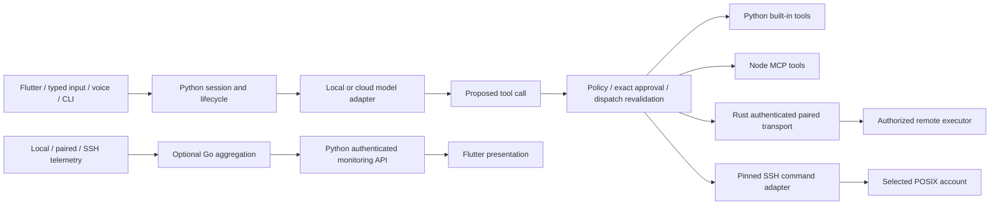

# Odessy 架构：面向新人的导览

[English](../ARCHITECTURE.md) | **简体中文** | [Español](../es/ARCHITECTURE.md)

**开发者预览 · v0.5.0-alpha**

> 说明：英文文档为权威版本（canonical），本页为简体中文翻译，仅供参照；界面截图显示英文界面，应用本身尚未本地化。

桌面端启动服务。模型提出操作，服务在派发前检查策略和审批。执行目标可以是本机，也可以是另行授权的电脑。这套设计支撑 Odessy 以语音为主的目标。

第一次改动时可查[文件与测试表](CONTRIBUTING.md#选择从哪里开始)。

## 架构主张

## 操作在哪里被把关

| 边界 | 实际源码 | 需要保持的要点 |
| --- | --- | --- |
| 提议与调度 | [`runtime/agent_loop.py`](../../src/odessy/runtime/agent_loop.py) | 筛选提议，快照其计划，并在调度前立即重新校验。 |
| 策略与精确批准 | [`authority/policy.py`](../../src/odessy/authority/policy.py)、[`action_approval.py`](../../src/odessy/authority/action_approval.py) | 硬性拒绝、精确的参数/目标/内容，以及独立的授权范围。 |
| 交互与模式 | [`interaction/broker.py`](../../src/odessy/interaction/broker.py)、[`application/access_modes.py`](../../src/odessy/application/access_modes.py) | UI/语音的回答会解决绑定的请求。模式不能创造工作区或远程权限。 |
| 执行适配器 | [`tools/`](../../src/odessy/tools)、[`tools/src/`](../../tools/src)、[`execution/`](../../src/odessy/execution) | 适配器特定的校验和可用的隔离限制。MCP 协议本身不是权限授予。 |
| SSH 命令 | [`tools/ssh_executor.py`](../../src/odessy/tools/ssh_executor.py) | 精确批准、固定的主机身份、有界输出和吊销；没有远程沙箱或 PTY。 |

并非每个工具都经由 Node 运行：Python 内置工具和 SSH 适配器同样存在。Go 监控不授予命令访问权限，Rust 配对身份与执行授权不同。实验性的可信 LAN 执行器边界不同；不要把它等同于已认证配对。MCU 自动化尚未实现。

## 桌面生命周期与开发入口

已安装应用使用 `InstalledApplication` 和 `InstalledCoordinator` 选择已验证的运行时，启动一个已认证的环回服务，通过私有 stdin 传递会话凭据，并关闭其拥有的子进程。源码托管桌面模式使用 `LocalDesktopApplication`，拥有相同的归属方和已保存的配置选择。参见[托管启动命令](./getting-started.md)。

`python -m odessy` 是一个已实现的模块入口，也作为 `odessy` 控制台命令暴露。`doctor`、无头 CLI 和手动管理的 `serve` 是开发者或操作员接口。它们的存在并不意味着桌面用户应交换 token 或启动第二个服务。引擎标识 `legacy` 当前指的是 **Custom**；它并不标记每个 Python 模块或 CLI 命令都已弃用。

Go 监控是可选的打包组件，并且保持主动选择（opt-in）。共享计算机模型、能力边界和夹具检查见 [SSH 贡献者路径](../../src/odessy/ssh/README.md)（English only）。打包一个辅助程序或通过本地夹具，并不能验证每个已安装平台或远程方向。

- [`tool/`](../../tool/) 放构建和验证脚本。
- [`tools/`](../../tools/) 是 Node MCP 服务。
- [`src/odessy/tools/`](../../src/odessy/tools/) 放 Python 工具适配器，包括 SSH 执行器。

| 组件 / 目录 | 语言与职责 | 贡献与评审 |
|---|---|---|
| [`src/odessy/runtime/`](../../src/odessy/runtime) 和 [`models/`](../../src/odessy/models) | Python 循环、会话、模型适配器 | 运行时/模型贡献者；调度安全需要维护者审阅 |
| [`src/odessy/authority/`](../../src/odessy/authority)、[`execution/`](../../src/odessy/execution) | Python 策略、工作区权威、沙箱 | **需要维护者审阅**；不是入门工作 |
| [`src/odessy/voice/`](../../src/odessy/voice) | Python 采集、STT/TTS 适配器和语音会话 | 提供商示例/测试；批准相关变更需要维护者审阅 |
| [`tools/`](../../tools) | TypeScript/Node MCP 工具和宿主检查 | 工具贡献者；防护与沙箱：**需要维护者审阅** |
| [`native/odessy-link/`](../../native/odessy-link) | Rust 身份、注册、mTLS 中继、遥测 | Rust 贡献者；注册、授权与密钥：**需要维护者审阅** |
| [`apps/desktop/`](../../apps/desktop) | Dart/Flutter 会话、设置、交互 | UI/无障碍贡献者；UI 不是执行权威 |
| [`packages/odessy_client/`](../../packages/odessy_client) | Dart 后端客户端和数据模型 | 客户端/API 贡献者；认证需要维护者审阅 |
| [`services/monitoring/`](../../services/monitoring) | Go 聚合/内部 API；可选，主动选择 | Go/可观测性贡献者；此处没有执行授权 |
| [`docs/`](./README.md) | Markdown/MDX 指南与证据 | 从[开放的 GitHub issue](https://github.com/Trisoma/odessy/issues)和[归属路径](./CONTRIBUTING.md#通往领域负责人的路径)开始 |

凭据存储和操作系统钥匙串集成，包括 [`src/odessy/credentials.py`](../../src/odessy/credentials.py) 和[凭据设置边界](../setup/secure-model-credentials.md)（English only）：**需要维护者审阅**。编辑桌面/客户端代码前，请先阅读组件本地的 `AGENTS.md` 说明。

**证据：**[运行时概览](../../README.zh-CN.md)、[批准](../reference/permissions.mdx#approval)（English only）、[当前配对范围](../reference/host-pairing.mdx)（English only）、[监控状态](../monitoring/README.md)（English only）、[发布限制](./current-status.md)。MCU 支持仍是未来方向；隔离限制和物理语音可靠性需要链接的支持矩阵中平台特定的检查。

## 持久的应用服务

模型适配器位于 `src/odessy/models/`。`src/odessy/model_providers.py` 中的共享提供商元数据也服务于最小的安装引导流程。本地调用方使用 `models.build_local_model`，共享预设位于 `models/__init__.py`。Ollama 聊天适配器接受已配置的模型名，包括预设族之外的模型。两个本地适配器共享 `ollama_model.py` 中有界的 HTTP 传输。规范的聊天实现是 `models/ollama_chat.py`。诸如 `odessy.agent_loop` 这样的历史扁平导入已退役。请使用领域导入，例如 `odessy.runtime.agent_loop`。

生产应用组合负责对话 SQLite 生命周期、Custom 续接、访问模式以及可信的实时工作区/会话解析。上下文、记忆和检索扩展该存储，但不会成为授权来源。终端句柄是临时的；检查点拥有 Git ref 和元数据，而不是用户分支或任意文件。Harness 保持可选，且没有自动回退。参见[历史](../ui/conversation-history.md)（English only）、[数据库归属](../database/README.md)（English only）和[当前支持矩阵](./current-status.md)。

## Python 源码组织

`src/odessy` 是可安装的 Python 包。请将代码保留在其所属领域内。

| 目录 | 职责 |
| --- | --- |
| `application/` | API 路由、会话生命周期和持久的应用服务 |
| `runtime/` | 智能体循环、调度、钩子和有界的对话历史 |
| `runtime_backends/` | 运行时引擎契约和 Custom/Harness 适配器 |
| `models/` | 模型适配器、本地构造、路由和用量 |
| `authority/` | 策略、批准、脱敏和审计边界 |
| `execution/` | 宿主隔离、资源限制和执行提供商 |
| `tools/` | MCP 客户端、服务器和受防护的工具传输 |
| `voice/` | 音频采集、播放、语音提供商和语音交互 |
| `collaboration/` | 参与者、任务和交接 |
| `config/` | 配置加载、校验和诊断 |
| `setup/` | 安装、维护和组件配置 |
| `monitoring/`、`ssh/`、`devices/` | 宿主监控、SSH 身份和设备声明 |

路由组合现有的服务归属方。模型适配器通过共享运行时类型生成提议。权威和执行在调度时强制授权。请将与通道无关的对话逻辑放在 `runtime/`，将音频逻辑放在 `voice/`。
