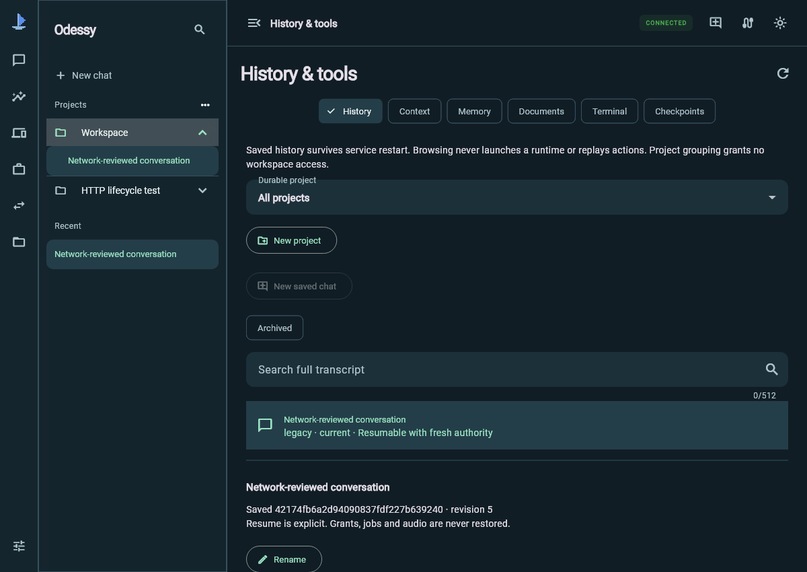
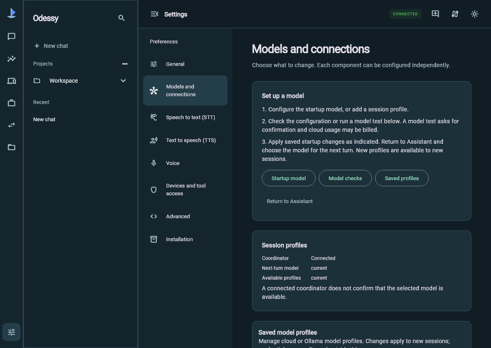
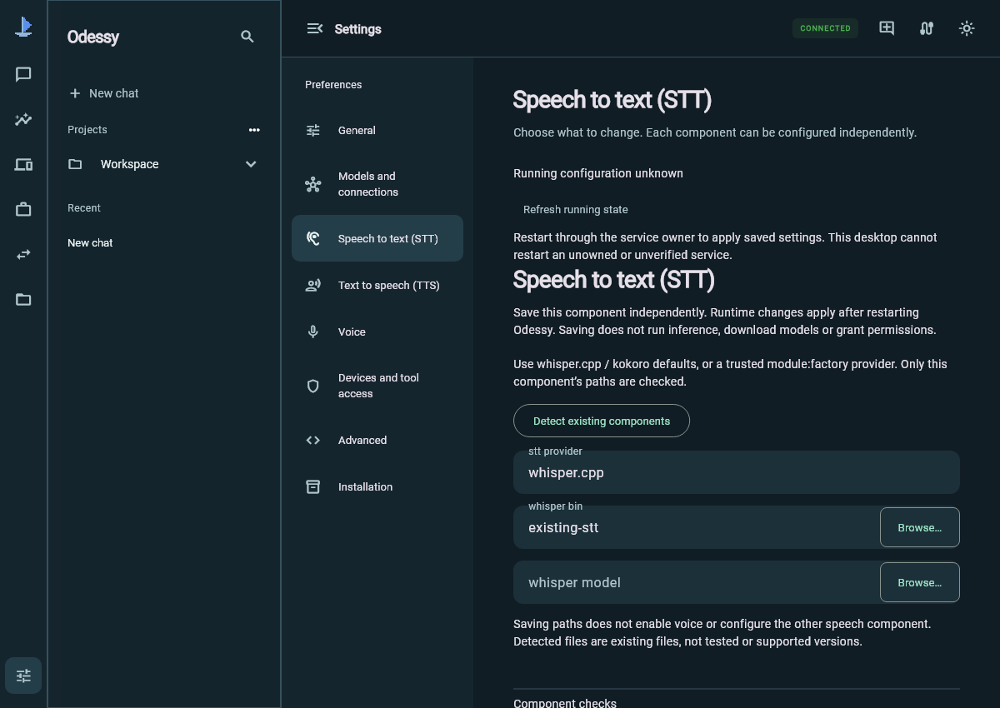
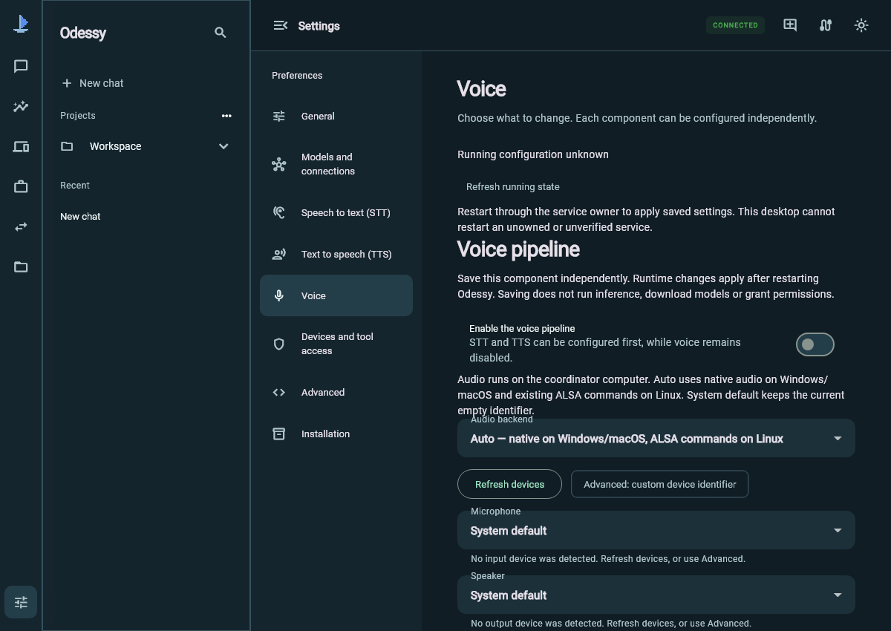

# Odessy 桌面版操作手册

[English](../GOLDEN_PATH.md) | **简体中文** | [Español](../es/GOLDEN_PATH.md)

**开发者预览 · v0.5.0-alpha**

> 说明：英文文档为权威版本（canonical），本页为简体中文翻译，仅供参照；界面截图显示英文界面，应用本身尚未本地化。

在 Windows 11 x64 上打开 Odessy，连接模型，再核对一条本地命令的实际输出。第一次只需一台电脑，语音和 SSH 可以稍后再试。

## 1. 安装并打开 Odessy

### 前置条件

本例需要联网、一个可丢弃的本地文件夹，以及能访问所选模型的 DeepSeek 密钥。无需 GPU、麦克风或第二台电脑。

DeepSeek 可能对请求收费，并会收到请求数据及获准发送的工具结果。Windows 上的隔离有局限。

### A. 在 Windows 上安装

[下载 Windows x64 安装包](https://github.com/Trisoma/odessy/releases/download/v0.5.0-alpha/Odessy-v0.5.0-alpha-windows-x64-setup.exe)。这个 EXE 早于 `08efca9` 的安全修复。如果需要这些修复，请[从源码启动](getting-started.md)。打开 EXE 前，在下载目录的 PowerShell 中运行：

```powershell
Get-FileHash -Algorithm SHA256 -LiteralPath '.\Odessy-v0.5.0-alpha-windows-x64-setup.exe'
```

预期 SHA-256: `2d634100c87251f3f685fdf0a43b734b534b08b6d8643d7e1458c25992abf47a`.

1. 打开已校验的 EXE，选一个目录，保留默认的协调端和本地执行选项。安装包自带运行时。
2. 只用文字聊天可以跳过语音和唤醒。现在要加语音，则选择 **Install voice components**，选 **Piper**（CPU 推荐）或 **Kokoro**，检查下载内容和许可。唤醒模型需要单独选择。见[语音组件](../setup/voice-components.md)。
3. 检查安装计划，选择 **Install**，等待完成后点 **Open Odessy**。

更新已有的版本化安装时，使用它记录的位置，在 **Manage installation** 中查看更新计划。保留用户配置和语音资源。见[安装维护](../setup/wizard.md#management)和[语音缓存恢复](../setup/voice-components.md#upgrading-after-removing-the-speech-cache)。

### B. 从源码构建生产桌面版

先按[入门指南](getting-started.md)启动，再回到这里配置模型。



*桌面图库示例。已有图库及 SSH 图片保留各自原始源码标识，并非本安装程序的新截图。*

## 2. 配置 DeepSeek

在 **Settings → Models and connections** 选 **DeepSeek**，保留 `https://api.deepseek.com/v1`，模型选我试过的 `deepseek-flash`。在遮蔽的输入框中填写 API 密钥，选 **Save securely** 或 **Use for this session only** 并保存。按提示应用或重新连接，也可点 **Connect saved configuration**。新建 Custom 对话，发送一条短消息，核对当前模型和回复。[凭据](../setup/secure-model-credentials.md)



*桌面截图库示例。在 Models and connections 中选择模型和提供商。*

## 3. 在你的 Windows 笔记本上运行命令

在 **Workspaces** 中选一个临时的本地文件夹。如果应用提示重启，按提示操作。断开当前用于执行命令的 SSH 或 LAN 目标。先运行 `hostname`，它会显示电脑的名称，不会修改文件。

1. 新建一个 **Custom** 聊天。在输入框旁的盾牌菜单（**Service permissions**）中选择 **Ask every time**，等服务确认切换成功。
2. 发送以下提示词：

   ```text
   Use terminal.run to run exactly hostname on this Windows laptop in the current workspace. Do not use SSH, substitute another command, or retry if I deny it. Show the tool's stdout and exit code.
   ```

3. 检查审批请求。工具应为本地的 `terminal.run`，命令应为 `hostname`，工作区应与你选的一致。如果没有出现审批请求，或任一项不符，先停下来[检查设置](#如果没有出现审批请求)。都一致后，选择 **Approve once**。
4. 在当前聊天打开 **Output**。检查退出码是否为 `0`，再用 PowerShell 运行一次 `hostname`，看看名称是否相同。

**到这里就可以了。** 模型已经回复，Odessy 也显示了你在这台电脑上批准执行的命令结果。

[](../view/main/basic-chat.png)

*图中是已安装的 Windows 预览版，**Output** 显示了列出文件的实际结果。你可以在同一位置查看自己的命令结果。*

### 可选：验证拒绝后命令是否停止

把同一条提示词作为新请求发送。确认命令和本地工作区都没变，再选择 **Deny**。检查这次请求是否被拒绝，以及是否没有成功执行的结果。如果模型提出其他命令，结束本轮。

## 4. 可选：配置语音和唤醒词

在本练习之前，请在已安装应用或托管源码应用中配置兼容的语音组件。源码构建依赖不包含语音模型或全部音频依赖；请遵循[语音组件](../setup/voice-components.md)（English only）。托管源码启动会使用已配置的语音生命周期，而单独启动的手动 API 服务器可能不包含它。

1. 在 **Settings**（设置）中打开 **Speech to text**（语音转文字）、**Text to speech**（文字转语音）和 **Voice**（语音），选择你支持的语音组件、麦克风和输出设备。保存更改。如果提示提供或下载资源，请遵循[语音组件](../setup/voice-components.md)（English only）。唤醒模型是单独的主动选择项。
2. 打开输入区的 **Voice options → Test speech output**（语音选项 → 测试语音输出）。然后选择 **Test speech input · no model call**（测试语音输入 · 不调用模型）并说一句简短的话。分别检查播放和转录。
3. 试试按住说话（push-to-talk）。然后启用唤醒监听。使用内置的 Jarvis 模型，说 **“Hey Jarvis”**，等待监听提示，然后问一个简短的问题。
4. 在更改音频设备之前，先从语音控件停止唤醒监听。如果某项设置更改被推迟，请先完成当前音频操作，并在音频空闲时确认更改生效。





*桌面截图库示例。语音识别负责配置转录。语音设置控制监听行为。*

如果没有转录，请从麦克风和输入测试开始。如果转录出现后文本到达缓慢，请检查模型响应。如果文本先于语音出现，请检查语音合成和所选说话人。在测试配置上语音可能感觉较慢。报告时请注明你观察到延迟的阶段。

## 5. 可选：通过 SSH 在另一台计算机上运行命令

与本地练习一样，`hostname` 会打印所选计算机的名称。这里命令在 SSH 计算机上运行，而不是在你的 Windows 笔记本上。实际搭建示例是一台 **Jetson Orin Nano Super**。请使用你自己可访问、带 POSIX shell 的 SSH 计算机，以及一个你已经能登录的账号。本指南省略连接地址，截图中的这类信息已打码。

1. 在 **Devices → Connect a computer**（设备 → 连接计算机）中，输入 SSH 别名或 `user@hostname`。如需要，填写端口。密码留空以使用你已配置的 SSH 密钥或 agent。请独立核验主机密钥；如果它未知或已更改，请遵循 [SSH 信任说明](../setup/ssh-computers.md)（English only）。

   

   *登录到维护者的 Debian 计算机后的真实安装版 Odessy 窗口。地址、端口和地址辅助示例均已打码以保护隐私。密码字段为空。请使用你自己的连接信息。*

2. 选择 **Connect**（连接）。登录会启动只读监控。打开 **Devices → Overview**（设备 → 概览）找到已连接的计算机及其发现的主机名。请将监控的新鲜度与登录状态分开检查。

   

   *真实的 Devices 概览。已连接的 Debian 计算机报告主机名 `localhost`，并通过只读 SSH 监控显示为在线。单独的 `jetson` 卡片是一个已保存条目，并不是本截图中所连接的计算机。连接身份信息已打码。*

3. 返回 **Connect a computer**。仅登录并不会启用智能体命令：下方状态显示 **Agent commands · not selected**。滚动到 **Use for agent commands** 并单独选择它。这会打开一个新的 Custom 聊天，其中 SSH 工具可用。

   

   *真实的安装版 Odessy 窗口，滚动到显示 **Use for agent commands** 的位置。登录和传输已验证；会话在线且就绪，而智能体命令仍为 **not selected**。本截图拍摄于命令访问启用之前。私有连接信息已打码。*

4. 在新聊天中输入 **“On the selected SSH computer, run `hostname` using `ssh.run`.”**。在批准中检查确切的命令和目标，并拒绝一次。确认该请求没有成功的远程结果。再次询问，检查批准，然后批准一次。在当前聊天的 **Output** 面板中检查返回的工具输出和退出码。
5. 比较两个练习：本地 `hostname` 应返回你的 Windows 笔记本名称；远程 `hostname` 应返回所选 SSH 计算机的名称。完成后选择 **Disconnect agent commands**。

维护者保存的 SSH 交互来自另一台 **Debian x86-64 计算机**，而不是 Jetson 设置示例。其记录的 `ssh.run` 结果为：

```text
stdout: localhost
exit code: 0
```

这是已确认工具结果的文本摘录，不是命令结果截图。`localhost` 是那台 Debian 计算机配置的主机名；它并不意味着 SSH 命令在 Windows 协调端上运行。在你自己的主机上，请在独立的 SSH 会话中用 `hostname` 对照。

重新打开已保存的 SSH 聊天时，助手回复可见，但恢复会话的 **Output** 面板为空。没有保存实时 SSH 工具输出的截图。上面的真实连接和 Devices 截图确立了登录与连接状态；它们并不展示命令执行。做练习时，请在命令的实时会话仍活动时检查 Output。

全窗口 SSH 截图取自 **2026 年 11 月 18 日**的已安装应用。其已安装可执行文件身份、隐私编辑和证据限制记录在[截图清单](../view/manual-ssh-live/manifest.json)中。

当前 SSH 流程有若干手动步骤。监控和命令选择使用不同控件，启用命令会启动新聊天，重启服务需要重新连接。命令以 SSH 账号的权限运行，且没有远程沙箱。请用批准中显示的目标来区分远程命令和笔记本命令。[SSH 指南](../setup/ssh-computers.md)（English only）涵盖连接丢失和支持的目标。

## 6. 可选：探索桌面版

| 位置 | 可尝试的操作 |
| --- | --- |
| **Projects and history**（项目与历史） | 创建或切换项目、打开已保存的聊天、搜索历史，或使用聊天菜单重命名、置顶、归档或导出。Custom 支持重启后的有界续接。Harness 重启后的历史为只读。 |
| **Composer**（输入区） | 为下一轮更改模型。打开服务权限并检查生效模式。SSH 命令仍需要显式批准。 |
| **Inspector**（检查器） | 浏览工作区的 **Files**（文件）、记录的 **Output**（输出）和 **Changes**（变更）。可用的交互式 **Terminal**（终端）使用单独的 shell 授权，并在你的操作系统账号下运行。[终端与检查点](../ui/terminal-checkpoints.md)（English only） |
| **Context, memory and documents**（上下文、记忆与文档） | 查看某一轮使用的上下文、审阅项目记忆，或主动启用文档索引并跟随检索引用。可用性取决于运行时和配置。 |
| **Checkpoints**（检查点） | 审阅或预览记录的工作区检查点。Windows 支持检查点的创建、列出、预览和恢复；恢复使用目录句柄锚定保护。 |
| **Activity & usage**（活动与用量） | 查看此安装记录的活动和模型用量。 |
| **Devices, Jobs and Handoffs**（设备、任务与交接） | 检查可用主机，然后在相应功能有活动时查看记录的任务或交接。 |
| **Settings**（设置） | 探索通用外观、模型与连接、语音转文字、文字转语音、语音、设备与工具访问、高级设置和安装维护。 |

[浏览带插图的桌面截图库](../view/README.md)（English only） · [当前限制](./LIMITATION.md)

## 故障排查与报告

这些是本次演练中的已知约束和可能的失败点。[完整限制](./LIMITATION.md)还涵盖核心路径之外的能力。

| 症状或边界 | 应采取的措施 |
| --- | --- |
| Python、npm 或 Flutter 安装失败 | 检查前置条件、Python 3.13 启动器、Node 22 和 `flutter doctor -v`。原生构建需要 Windows C++ 工具。依赖/构建命令失败后不要继续。 |
| 启动失败、连接被拒绝或 HTTP 401 | 在托管应用中检查启动错误和已保存配置，然后重试 **Connect saved configuration**。它掌管自己的端口/token。源码构建需要全部托管启动 defines。只有刻意的手动 API 连接才使用操作员输入的端口/token。 |
| 模型报告认证、模型未找到、速率限制或额度错误 | 检查提供商端点、当前模型 ID 和账号访问/额度。doctor 找到密钥并不代表在线验证通过。报告提供商错误时不要附带密钥。不要假定失败的请求是免费的。 |
| 安全密钥保存失败 | 有意选择 **Use for this session only**，或修复受支持的操作系统凭据后端。两条托管启动路径都会以私密方式传递会话凭据；将密钥以明文保存不是变通方案。 |
| 没有出现批准，或出现不同的命令/目标 | 检查 Custom、生效的 **Ask every time**、本地目标、所选工作区以及任何已保存的命令预授权/钩子。拒绝不匹配的请求；参见[策略检查](#如果没有出现审批请求)。面板或模式选择都不会授予新的工作区权限。 |
| 被拒绝的命令再次被提出 | 拒绝不会执行该建议。停止本轮并报告重复提出的情况；不要为了让界面继续而批准它。 |
| 命令失败或退出码非零 | 阅读实际的 Output 和批准参数。检查工作区有效性和 shell/工具就绪情况。不要禁用隔离限制，也不要把 Full control（完全控制）当作安装变通方案。Windows 的隔离限制即使命令成功也仍然不完整。 |
| 重新打开历史后 Output 为空 | 维护者观察到恢复的 SSH Output 面板为空。在关闭聊天前检查并捕获实时工具结果；不要仅为重建证据而重跑操作。历史和助手文字不是新执行的证明。 |
| 已保存的聊天无法继续 | 使用匹配的配置文件/工作区。Custom 的续接是有界的；Harness 重启后的历史为只读。不要通过删除历史数据库来修复选择问题。 |
| 可选语音或 Devices 不可用 | 键入式本地聊天不需要其中任一功能。检查所选音频设备和单独的 STT/TTS 测试；SSH 登录、监控就绪与命令授权是分开的。服务重启后重新连接临时 SSH 会话。 |
| 云端或 shell 操作暴露数据 | 云请求和经允许的工具观察内容会发送给已配置的提供商。Shell 操作具有文档所述的宿主权限；批准并不是完整的操作系统沙箱。请使用一次性的非敏感数据。检查点恢复只还原收录的文本文件，不能作为已执行命令的回滚手段。 |

### 如果没有出现审批请求

在默认策略下，下面的非执行检查会报告 `decision: confirm` 和 `asks: true`。如果界面意外跳过了批准，请在你的一次性工作区中用源码环境的 Python 运行：

```powershell
$previewPython = 'C:\path\to\odessy-preview\.venv\Scripts\python.exe'
& $previewPython -m odessy permissions check 'hostname' --json
```

请将 `C:\path\to\odessy-preview` 替换为实际的源码目录。此可选诊断需要该源码目录的 Python 环境；仅使用安装版的用户可改为报告界面中的审批信息和 Output。

该检查不会运行 `hostname`，也不会覆盖实时模式、自定义规则、钩子或已保存的预授权。**Ask every time** 并不意味着每个无害的读取都会弹出提示。如果你的配置不同，请报告它；不要为了让本练习通过而削弱策略。

### 收集诊断信息

**安装版：**打开 **Settings → Manage installation → Check installed files**，记录构建版本。**源码版：**参照[诊断启动失败](getting-started.md#诊断启动失败)中的命令和适用范围。

[提交问题](https://github.com/Trisoma/odessy/issues/new/choose)时，附上构建版本、Windows 版本、失败的步骤和实际结果。如果试了命令，请附上目标、输出和退出码。如果试了 **Deny**，说说当时发生了什么。分享日志或截图前，删掉密钥、令牌、私有地址和敏感路径。

## 帮助改进你刚试过的部分

从[路线图](../ROADMAP.md)选一个问题，再看[贡献指南](CONTRIBUTING.md)中的第一项测试。
